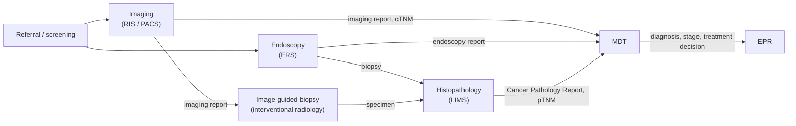

<b>Proof of concept.</b> This implementation guide is a demonstration only. It is
<b>not</b> an authoritative source, is not endorsed by NHS England, IHE or HL7, and
must not be used for implementation or clinical purposes. It is background for the
<a href="https://kevinmayfield.github.io/CancerPathologyReport/">Cancer Pathology Report</a>
proof of concept.

Imaging and pathology meet at several points on the cancer pathway. The
[Cancer Pathology Report](https://kevinmayfield.github.io/CancerPathologyReport/) IG
covers this from the pathology side on its
[Imaging and Radiology](https://kevinmayfield.github.io/CancerPathologyReport/Imaging.html)
page; this page gives the imaging side.

### References

- [COSD v10 Core - Imaging](https://digital.nhs.uk/ndrs/data/data-sets/cosd/cosd-user-guide-v10/core---imaging) - National Disease Registration Service
- [Cancer Pathology Report - Cancer Pathway](https://kevinmayfield.github.io/CancerPathologyReport/CancerPathway.html)

### Where Imaging Meets Pathology

| Point | Imaging | Pathology |
|---|---|---|
| **Detection** | Imaging (or endoscopy) usually finds the lesion, often after screening or an urgent suspected cancer referral | No specimen yet |
| **Specimen collection** | Image-guided biopsy by interventional radiology (ultrasound, CT, stereotactic); biopsy at [endoscopy](Endoscopy.html) | Histopathology request ([LAB-1](https://kevinmayfield.github.io/CancerPathologyReport/LAB-1.html)), with the imaging report as supporting information |
| **Staging** | Clinical stage (cTNM), mostly from CT, MRI and PET-CT | Pathological stage (pTNM, ypTNM) in the pathology report |
| **MDT** | Imaging reviewed by radiologist | Radiology-pathology correlation; discordance can lead to repeat biopsy or further imaging |
| **Specimen imaging** | Specimen radiography of excisions | Informs gross description; digital pathology for slides - see [Other Imaging Specialties](OtherImaging.html) |
{:.grid}

### COSD Imaging

COSD records imaging in its own **Core - Imaging** section, separate from COSD
Pathology. In COSD v10:

| Item | Notes |
|---|---|
| CR1610 Imaging Code (NICIP) | Imaging procedure, NICIP code (up to 6 characters); one per imaging event |
| CR3110 Imaging Code (SNOMED CT) | Alternative to NICIP |
| CR0340 Imaging Anatomical Site | Body site imaged |
| CR0350 Lesion Size (Radiological) | **Retired** in v10 |
| Image-guided procedures | Recorded in the COSD Diagnostic Procedures section (OPCS), not in Imaging |
{:.grid}

The full item list, formats and any other items in the group are **To confirm**
against the COSD v10 user guide.

### FHIR

- The imaging report is a `DiagnosticReport` with category `RAD`; it can be
  referenced from the histopathology request (`ServiceRequest.supportingInfo`).
- `Condition.evidence` and `Condition.stage.assessment` on the cancer condition
  can reference both imaging and pathology reports. This belongs to the
  condition, not to either report.

See [FHIR Resources](DataModel.html).
