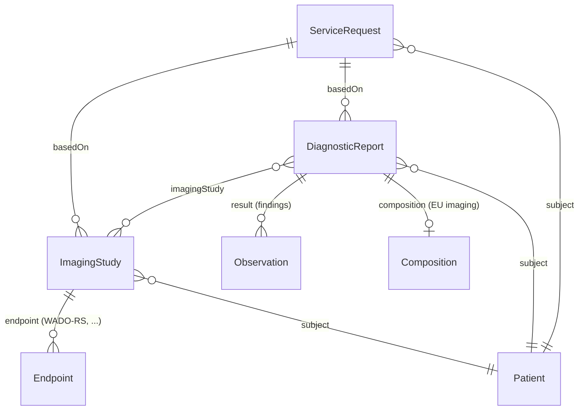

<b>Proof of concept.</b> This implementation guide is a demonstration only. It is
<b>not</b> an authoritative source, is not endorsed by NHS England, IHE or HL7, and
must not be used for implementation or clinical purposes. It is background for the
<a href="https://kevinmayfield.github.io/CancerPathologyReport/">Cancer Pathology Report</a>
proof of concept.

This page shows the FHIR resources used for imaging orders, studies and reports.
This guide's profiles are derived from
[HL7 Europe Imaging Report](https://hl7.eu/fhir/imaging/), the imaging
counterpart of [HL7 Europe Laboratory Report](https://hl7.eu/fhir/laboratory/),
which the Cancer Pathology Report IG is built on.

### Profiles

| Artefact | Based on | Use |
|---|---|---|
| [Radiology Report](StructureDefinition-RadiologyReport.html) (logical model) | RCR report data items | Content of a radiology report, with indicative HL7 v2, DICOM and FHIR mappings |
| [Patient](StructureDefinition-Patient.html) | `patient-eu-core` | NW core Patient (copied from the [NW GMSA FHIR IG](https://nw-gmsa.github.io/en/)) - NHS number and MRN identifiers. All this guide's profiles reference it |
| [Radiology Service Request](StructureDefinition-RadiologyServiceRequest.html) | `ServiceRequestOrderEuImaging` | Imaging request: NICIP code (required) with SNOMED CT map, accession number |
| [Radiology Imaging Study](StructureDefinition-RadiologyImagingStudy.html) | `ImagingStudyEuImaging` | DICOM study metadata, with DICOM tags in the element descriptions |
| [Radiology Diagnostic Report](StructureDefinition-RadiologyDiagnosticReport.html) | `DiagnosticReportEuImaging` | The radiology report; `code` carries the NICIP examination code and/or LOINC report type, as in Interweave |
| [Radiological Accession Number](StructureDefinition-RadiologicalAccessionNumber.html) | `AccessionNumberIdentifierEuImaging` | Accession number, issuer identified by ODS code |
| [Imaging Order (O19)](MessageDefinition-imaging-order.html) (message definition) | FHIR Messaging | FHIR Message equivalent of `OMG^O19` - [RAD-2](RAD-2.html) and [RAD-3](RAD-3.html), focus Radiology Service Request |
| [Procedure Scheduled (O23)](MessageDefinition-procedure-scheduled.html) (message definition) | FHIR Messaging | FHIR Message equivalent of `OMI^O23` - [RAD-4 / RAD-13](RAD-4.html), focus Radiology Service Request and scheduled Radiology Imaging Study |
| [Imaging Result (R01)](MessageDefinition-imaging-result.html) (message definition) | FHIR Messaging | FHIR Message equivalent of `ORU^R01` - [RAD-128](RAD-128.html), focus Radiology Diagnostic Report |
| [Bundle Message](StructureDefinition-BundleMessage.html), [MessageHeader](StructureDefinition-MessageHeader.html) | `Bundle`, `MessageHeader` | FHIR Messaging, copied from the [NW GMSA FHIR IG](https://nw-gmsa.github.io/en/); `eventCoding` is the HL7 v2 trigger event |
| [NICIP (Interweave)](ValueSet-Interweave-NICIP.html) (value set) | Interweave NICIP CodeSystem | NICIP codes for `ServiceRequest.code` and `DiagnosticReport.code` |
| [UK Imaging Procedure](ValueSet-uk-imaging-procedure.html) (value set) | SNOMED CT UK refset 999001111000000105 | Imaging procedure codes |
{:.grid}

`DiagnosticReportEuImaging` requires a `CompositionEuImaging` (the
`composition` extension), so a report conforming to these profiles is also a
FHIR document. Whether NHS reports, mostly sent today as HL7 v2 ORU with a text
report, can meet this is **Open**.

### Examples

A staging CT of the thorax, abdomen and pelvis at Manchester University NHS
Foundation Trust (R0A), for the NW GMSA test patient MANCHESTER Sansa (see the
[NW GMSA test patients](https://github.com/nw-gmsa/Testing/blob/main/MRN-Mapping.md)).
Practitioners, identifiers and report text are fictional.

| Example | Profile |
|---|---|
| [Radiology Service Request](ServiceRequest-RadiologyServiceRequestExample.html), and as a [new order](ServiceRequest-RadiologyServiceRequestNewOrder.html) | Radiology Service Request |
| [Imaging Order (O19), new order](Bundle-ImagingOrderMessage.html) and [status change](Bundle-ImagingOrderStatusMessage.html), [Procedure Scheduled (O23)](Bundle-ProcedureScheduledMessage.html), [Imaging Result (R01)](Bundle-ImagingResultMessage.html) | Bundle Message |
| [Scheduled request](ServiceRequest-RadiologyServiceRequestScheduled.html) and [scheduled study](ImagingStudy-RadiologyImagingStudyScheduled.html) (RAD-4) | Radiology Service Request, Radiology Imaging Study |
| [Radiology Imaging Study](ImagingStudy-RadiologyImagingStudyExample.html), with a [WADO-RS Endpoint](Endpoint-EndpointWADORS.html) | Radiology Imaging Study |
| [Radiology Diagnostic Report](DiagnosticReport-RadiologyDiagnosticReportExample.html), with the [report PDF](Binary-RadiologyReportPDF.html) | Radiology Diagnostic Report |
| [Composition](Composition-RadiologyCompositionExample.html) | `CompositionEuImaging` |
{:.grid}

Following the NW GMSA convention, the report PDF is referenced by
`DiagnosticReport.presentedForm.url` (`Binary/RadiologyReportPDF`) rather than
embedded in `presentedForm.data`.

The accession number `system` in the examples (`http://example.org/R0A/accession-number`)
is a placeholder, because the convention is **Open**.

### References

- [HL7 Europe Imaging Report](https://hl7.eu/fhir/imaging/) - package `hl7.fhir.eu.imaging` 1.0.0-ballot, FHIR R4
- [FHIR R4 ImagingStudy](https://hl7.org/fhir/R4/imagingstudy.html), [DiagnosticReport](https://hl7.org/fhir/R4/diagnosticreport.html), [ServiceRequest](https://hl7.org/fhir/R4/servicerequest.html)
- [IHE RAD Interactive Multimedia Report (IMR)](https://profiles.ihe.net/RAD/) - IHE's first FHIR-based radiology profile

### Resources

| Resource | Use | Key elements |
|---|---|---|
| `ServiceRequest` | The imaging (or endoscopy) request from the Order Placer | `identifier` (placer order number, accession number), `code` (NICIP / SNOMED CT procedure), `reasonCode`, `supportingInfo` |
| `ImagingStudy` | Metadata of the DICOM study - not the pixel data | `identifier` (Study Instance UID, accession number), `modality`, `series`, `endpoint` |
| `Endpoint` | Where the images can be retrieved | `connectionType` (for example DICOM WADO-RS), `address` |
| `DiagnosticReport` | The imaging or endoscopy report | `category` (for example `RAD`), `code` (report type, LOINC), `imagingStudy`, `result`, `conclusion`, `presentedForm` |
| `Observation` | Coded findings | `code`, `value[x]`, `bodySite` |
| `DocumentReference` | The report as a document (for example PDF), or a key image | `type`, `content.attachment` |
{:.grid}

For document sharing metadata (IHE XDS DocumentEntry / MHD) see the NW GMSA
[DocumentReference](https://nw-gmsa.github.io/en/StructureDefinition-DocumentReference.html)
profile. It links to the imaging report through `context.related`, and the
accession number and order identifiers stay on the `DiagnosticReport`.

### Imaging Study and Imaging Report

The [EU eHealth Network guideline on medical imaging studies and reports](https://health.ec.europa.eu/document/download/0079ad26-8f8f-435b-9472-3cd8625f4220_en?filename=ehn_mi_guidelines_en.pdf)
separates the two:

| Term | Definition (summarised) |
|---|---|
| **Imaging study** | A set of objects, including images, made for a specific purpose, usually in response to a request. It does not include the imaging report. Not the same as the FHIR `ImagingStudy` resource, which holds only the study metadata |
| **Imaging report** | The observations and interpretation of one or more imaging studies: reason for the request, relevant clinical information, modality and procedure, body site, findings, conclusion and advice |
{:.grid}

### Imaging Report Data Items

The Royal College of Radiologists'
[Radiology reporting networks: understanding the technical options](https://www.rcr.ac.uk/media/wwtp2mif/rcr-publications_radiology-reporting-networks-understanding-the-technical-options_march-2022.pdf)
(March 2022; no longer at this address on the RCR website as of November 2026 -
current status **To confirm**) describes the data a radiology report carries between RIS, PACS
and reporting networks. An earlier NHS England draft radiology IG, written for
the National Imaging Registry, mapped these items to FHIR `DiagnosticReport`
following the [HL7 v2-to-FHIR ORU^R01 mapping](https://build.fhir.org/ig/HL7/v2-to-fhir/ConceptMap-message-oru-r01-to-bundle.html).
The table below is based on that draft. It has **not** been checked against the
RCR text (**To confirm**), and the HL7 v2 and DICOM columns are indicative.
[Radiology Report](RadiologyReport.html) gives the same items grouped as a report,
with the FHIR document layout and a mock of the document.

| Data item | FHIR DiagnosticReport | HL7 v2 (ORU) | DICOM | NHS Data Dictionary |
|---|---|---|---|---|
| Report identifier | `identifier` | OBR-3 Filler Order Number | | |
| Patient | `subject` (NHS number) | PID-3 Patient Identifier List, PID-5 Patient Name | (0010,0020) Patient ID | NHS NUMBER |
| Accession number | `basedOn` (ServiceRequest `identifier`) | ORC-3 / OBR-3 Filler Order Number | (0008,0050) Accession Number, (0008,0051) Issuer of Accession Number | RADIOLOGICAL ACCESSION NUMBER |
| Visit number | `encounter` | PV1-19 Visit Number | | |
| Examination (NICIP) | `code` | OBR-4 Universal Service Identifier | (0008,1032) Procedure Code Sequence | IMAGING CODE (NICIP) |
| Diagnostic service section | `category` | OBR-24 Diagnostic Serv Sect ID | | |
| Examination completed | `effectiveDateTime` or `effectivePeriod` | OBR-7 Observation Date/Time, OBR-8 Observation End Date/Time | | |
| Final report issued | `issued` | OBR-22 Results Rpt/Status Chng - Date/Time | | |
| Imaging site | `performer` (Organization, ODS code) | PV1-3 Assigned Patient Location (facility) | (0008,0082) Institution Code Sequence | SITE CODE (OF IMAGING) |
| Operator (radiographer) | `performer` (Practitioner) | OBR-34 Technician | (0008,1070) Operators' Name, (0008,1072) Operator Identification Sequence | |
| Primary reporter | `resultsInterpreter` (Practitioner) | OBR-32 Principal Result Interpreter | (0008,1060) Name of Physician(s) Reading Study, (0008,1062) Physician(s) Reading Study Identification Sequence | |
| Secondary reporter | `resultsInterpreter` (Practitioner) | OBR-33 Assistant Result Interpreter | (0008,1062) | |
| Report text (narrative, clinical history, radiographer comments) | `presentedForm`, or a FHIR document (`composition`) | OBX-5, NTE-3 | DICOM Structured Report | |
| Conclusion | `conclusion` | | | **Open** - whether the RCR data set separates it |
{:.grid}

Notes:

- Practitioners are identified by professional registration number: GMC for
  radiologists, HCPC for radiographers, NMC for nurses. The NHS Data Dictionary
  CONSULTANT CODE gives the formats. The draft distinguished the primary and
  secondary roles with the `performerFunction` extension (v3 ParticipationType
  `PPRF` / `SPRF`).
- Imaging site: the NHS Data Dictionary SITE CODE (OF IMAGING) is a site code,
  not an organisation code. Which to use in `performer` is **Open**.
- `category` carries the HL7 v2 diagnostic service section (for example `RAD`,
  see [Terminology](terminology.html)). The DICOM modality, (0008,0060),
  belongs on `ImagingStudy.modality`.
- [IHE RAD IMR DiagnosticReport](https://profiles.ihe.net/RAD/IMR/StructureDefinition-imr-diagnosticreport.html)
  and HL7 Europe `DiagnosticReportEuImaging` should be compared with this list
  before any profile is written (**Open**).

### Imaging Study Data Items

`ImagingStudy` holds study metadata from the DICOM
[General Study module](https://dicom.nema.org/medical/dicom/current/output/chtml/part03/sect_C.7.2.html)
(Part 3, C.7.2.1). Indicative mapping:

| DICOM attribute | Tag | FHIR ImagingStudy |
|---|---|---|
| Study Instance UID | (0020,000D) | `identifier` (`urn:dicom:uid`) |
| Accession Number, Issuer of Accession Number | (0008,0050), (0008,0051) | `identifier` (type `ACSN`), `basedOn` |
| Study Date, Study Time | (0008,0020), (0008,0030) | `started` |
| Study Description | (0008,1030) | `description` |
| Procedure Code Sequence | (0008,1032) | `procedureCode` (NICIP / SNOMED CT) |
| Referring Physician's Name | (0008,0090) | `referrer` |
| Name of Physician(s) Reading Study | (0008,1060) | `interpreter` |
| Reason For Performed Procedure Code Sequence | (0040,1012) | `reasonCode` |
| Patient ID | (0010,0020) | `subject` |
| Modality (series) | (0008,0060) | `series.modality` |
| Series Instance UID | (0020,000E) | `series.uid` |
| SOP Instance UID | (0008,0018) | `series.instance.uid` |
{:.grid}

### Accession Number

The accession number links the request, the DICOM study and the report. It is
defined by the NHS Data Dictionary as
[RADIOLOGICAL ACCESSION NUMBER](https://www.datadictionary.nhs.uk/data_elements/radiological_accession_number.html).
Indicative representation:

| Standard | Value | Issuing organisation |
|---|---|---|
| DICOM | (0008,0050) Accession Number | (0008,0051) Issuer of Accession Number Sequence |
| HL7 v2 | CX.1, with CX.5 identifier type `ACSN` | CX.6 assigning facility (ODS code) |
| FHIR | `Identifier.value`, with `Identifier.type` = `http://terminology.hl7.org/CodeSystem/v2-0203#ACSN` | `Identifier.system` unique to the issuing organisation; `Identifier.assigner` (ODS code) |
{:.grid}

Accession numbers are only unique within the issuing RIS, so the `system` (or
issuer) is required when they are shared between organisations. A convention
for the `system` URI is **Open**. HL7 Europe Imaging Report has an
`AccessionNumberIdentifierEuImaging` profile (see below).

### HL7 Europe Imaging Report Profiles

Selected profiles from `hl7.fhir.eu.imaging` 1.0.0-ballot:

| Profile | Resource |
|---|---|
| `ServiceRequestOrderEuImaging` | ServiceRequest |
| `ImagingStudyEuImaging` | ImagingStudy |
| `DiagnosticReportEuImaging` | DiagnosticReport |
| `CompositionEuImaging` | Composition (the report as a FHIR document) |
| `BundleReportEuImaging` | Bundle (document) |
| `ObservationFindingEuImaging` | Observation |
| `ProcedureEuImaging` | Procedure |
| `DocumentReferenceImagingReport` | DocumentReference |
| `AccessionNumberIdentifierEuImaging`, `StudyInstanceUidIdentifierEuImaging` | Identifier datatype profiles |
{:.grid}

The package is a ballot version and depends on `hl7.fhir.eu.base` 2.0.0-ballot,
`ihe.iti.mhd`, `fhir.dicom` and the R5 cross-version package. The Cancer
Pathology Report IG uses `hl7.fhir.eu.base` 2.0.1. This guide depends on
`hl7.fhir.eu.imaging` 1.0.0-ballot, and will move to the published version when
it is available.

### Comparison with the Pathology Report

| | Pathology (Cancer Pathology Report IG) | Imaging (this guide) |
|---|---|---|
| Base IG | HL7 Europe Laboratory Report | HL7 Europe Imaging Report |
| Report | `DiagnosticReport-eu-lab` | `DiagnosticReportEuImaging` |
| What was examined | `Specimen` | `ImagingStudy` (no specimen) |
| Workflow | IHE PaLM Laboratory Testing Workflow (LTW) | IHE RAD Scheduled Workflow (SWF.b) |
| Request identifier | Placer / filler order number | Placer order number, accession number |
{:.grid}
