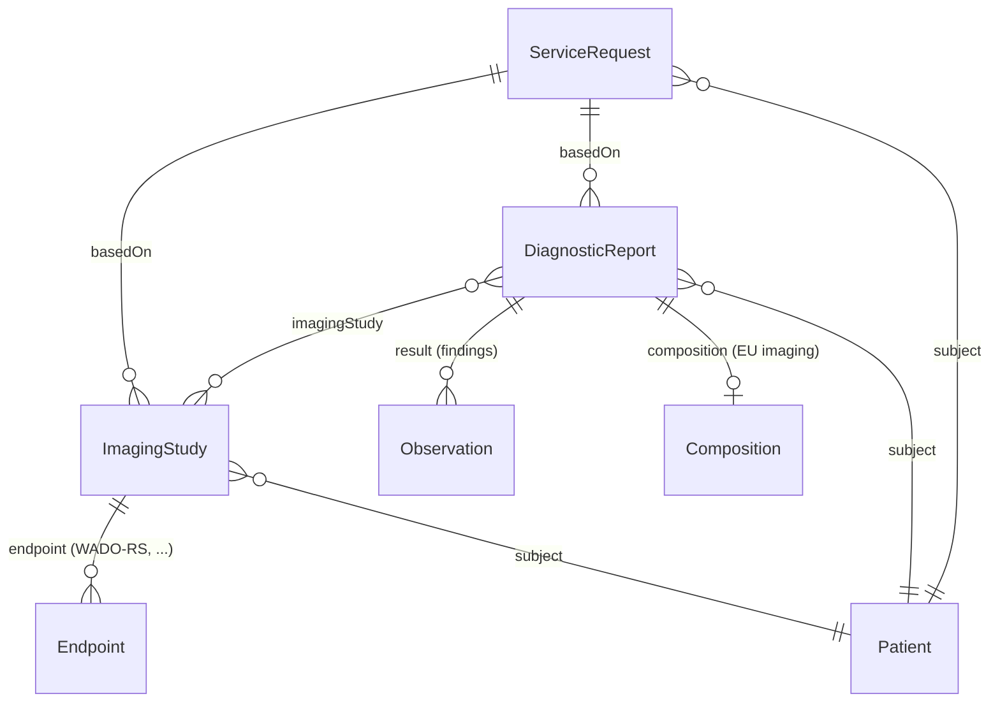

<b>Proof of concept.</b> This implementation guide is a demonstration only. It is
<b>not</b> an authoritative source, is not endorsed by NHS England, IHE or HL7, and
must not be used for implementation or clinical purposes. It is background for the
<a href="https://nw-gmsa.github.io/CancerPathologyReport/">Cancer Pathology Report</a>
proof of concept.

This page shows the FHIR resources used for imaging orders, studies and reports.
This guide **does not define profiles**. For the imaging report it points to
[HL7 Europe Imaging Report](https://hl7.eu/fhir/imaging/), the imaging
counterpart of [HL7 Europe Laboratory Report](https://hl7.eu/fhir/laboratory/),
which the Cancer Pathology Report IG is built on.

### References

- [HL7 Europe Imaging Report](https://hl7.eu/fhir/imaging/) - package `hl7.fhir.eu.imaging` 1.0.0-ballot, FHIR R4
- [FHIR R4 ImagingStudy](https://hl7.org/fhir/R4/imagingstudy.html), [DiagnosticReport](https://hl7.org/fhir/R4/diagnosticreport.html), [ServiceRequest](https://hl7.org/fhir/R4/servicerequest.html)
- [IHE RAD Interactive Multimedia Report (IMR)](https://profiles.ihe.net/RAD/) - IHE's first FHIR-based radiology profile

### Resources

| Resource | Use | Key elements |
|---|---|---|
| `ServiceRequest` | The imaging (or endoscopy) request from the Order Placer | `identifier` (placer order number, accession number), `code` (NICIP / SNOMED CT procedure), `reasonCode`, `supportingInfo` |
| `ImagingStudy` | Metadata of the DICOM study - not the pixel data | `identifier` (Study Instance UID, accession number), `modality`, `series`, `endpoint` |
| `Endpoint` | Where the images can be retrieved | `connectionType` (for example DICOM WADO-RS), `address` |
| `DiagnosticReport` | The imaging or endoscopy report | `category` (for example `RAD`), `code` (report type, LOINC), `imagingStudy`, `result`, `conclusion`, `presentedForm` |
| `Observation` | Coded findings | `code`, `value[x]`, `bodySite` |
| `DocumentReference` | The report as a document (for example PDF), or a key image | `type`, `content.attachment` |
{:.grid}

### HL7 Europe Imaging Report Profiles

Selected profiles from `hl7.fhir.eu.imaging` 1.0.0-ballot:

| Profile | Resource |
|---|---|
| `ServiceRequestOrderEuImaging` | ServiceRequest |
| `ImagingStudyEuImaging` | ImagingStudy |
| `DiagnosticReportEuImaging` | DiagnosticReport |
| `CompositionEuImaging` | Composition (the report as a FHIR document) |
| `BundleReportEuImaging` | Bundle (document) |
| `ObservationFindingEuImaging` | Observation |
| `ProcedureEuImaging` | Procedure |
| `DocumentReferenceImagingReport` | DocumentReference |
| `AccessionNumberIdentifierEuImaging`, `StudyInstanceUidIdentifierEuImaging` | Identifier datatype profiles |
{:.grid}

The package is a ballot version and depends on `hl7.fhir.eu.base` 2.0.0-ballot,
`ihe.iti.mhd`, `fhir.dicom` and the R5 cross-version package. The Cancer
Pathology Report IG uses `hl7.fhir.eu.base` 2.0.1. Whether to take a dependency
on the imaging package, and which version, is **Open**.

### Comparison with the Pathology Report

| | Pathology (Cancer Pathology Report IG) | Imaging (this guide) |
|---|---|---|
| Base IG | HL7 Europe Laboratory Report | HL7 Europe Imaging Report |
| Report | `DiagnosticReport-eu-lab` | `DiagnosticReportEuImaging` |
| What was examined | `Specimen` | `ImagingStudy` (no specimen) |
| Workflow | IHE PaLM Laboratory Testing Workflow (LTW) | IHE RAD Scheduled Workflow (SWF.b) |
| Request identifier | Placer / filler order number | Placer order number, accession number |
{:.grid}
