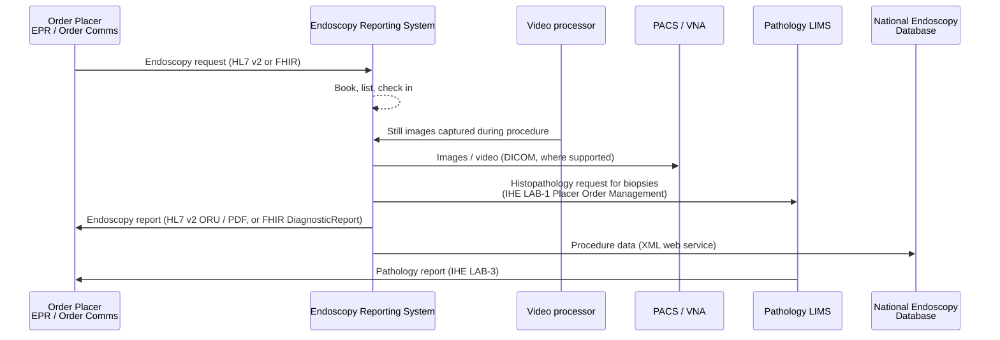

<b>Proof of concept.</b> This implementation guide is a demonstration only. It is
<b>not</b> an authoritative source, is not endorsed by NHS England, IHE or HL7, and
must not be used for implementation or clinical purposes. It is background for the
<a href="https://nw-gmsa.github.io/CancerPathologyReport/">Cancer Pathology Report</a>
proof of concept.

Endoscopy is usually supported by a specialist **Endoscopy Reporting System
(ERS)**, linked to the EPR and to the imaging archive. It is rarely a feature of
the EPR itself. Endoscopy matters to pathology because it is a major **specimen
collection** point: many cancer biopsies are taken at endoscopy.

### References

- [IHE Endoscopy (ENDO) Domain](https://profiles.ihe.net/ENDO/index.html) - three trial implementation profiles (2018): Endoscopy Ordering Workflow (EWF), Endoscopy Image Archiving (EIA), and Endoscopy Report and Pathology Order (ERPO)
- [Endoscopy Ordering Workflow](https://wiki.ihe.net/index.php/Endoscopy_Ordering_Workflow) and [Endoscopy Image Archiving](https://wiki.ihe.net/index.php/Endoscopy_Image_Archiving) - IHE wiki
- [Joint Advisory Group on GI Endoscopy (JAG)](https://www.thejag.org.uk/) - accreditation of endoscopy services; runs the National Endoscopy Database (NED)
- [RCP: JAG marks 15 million endoscopy procedures recorded](https://rcp.ac.uk/news-and-media/news-and-opinion/rcp-hosted-joint-advisory-group-on-gi-endoscopy-marks-15-million-endoscopy-procedures-recorded-since-2015/)

### Systems

| Part | Role | Examples |
|---|---|---|
| **Endoscopy Reporting System (ERS)** | Lists and booking, structured procedure report (OGD, colonoscopy, ERCP, EUS, ...), quality measures (sedation, comfort, completion), still image capture into the report, NED upload, often pathology requests for biopsies | Specialist products such as Medilogik EMS, Olympus EndoBase, Unisoft GI Reporting Tool, Solus, Provation |
| **Video processor and capture** | Scope image source; stills and video recording | Scope manufacturers' processors and recorders; theatre video integration systems |
| **Image archive** | Long-term storage of stills and video, increasingly DICOM into PACS or a VNA | Trust PACS / VNA |
| **Decontamination traceability** | Which scope was used on which patient, and its decontamination | Part of the ERS, or a separate system |
{:.grid}

Product names are examples of the market, not a statement of what any trust uses.

### Workflow

### National Endoscopy Database

The [National Endoscopy Database (NED)](https://www.thejag.org.uk/) collects
procedure data from endoscopy units across the UK. The ERS uploads each procedure
to NED through a web service supplied by the ERS vendor. JAG reports that more
than 15 million procedures have been uploaded since 2015, from over 530 sites.
NED upload and JAG accreditation are related but separate processes.

### Endoscopy and Pathology

The IHE **Endoscopy Report and Pathology Order (ERPO)** profile covers creating
the endoscopy report and placing **pathology orders** from it. In the
[Cancer Pathology Report](https://nw-gmsa.github.io/CancerPathologyReport/) IG
the endoscopist is the **specimen collector**, and the pathology request is a
[Placer Order Management [LAB-1]](https://nw-gmsa.github.io/CancerPathologyReport/LAB-1.html)
interaction. Whether the request is placed from the ERS or from the EPR is a
local decision - **To confirm** for each trust.

### FHIR

- The endoscopy report is a `DiagnosticReport`. HL7 v2 table 0074 (diagnostic
  service section) has no endoscopy code, so the category is **Open** - see
  [Terminology](terminology.html).
- Endoscopy images in DICOM use the `ES` (Endoscopy) modality and appear in
  `ImagingStudy` like radiology images.
- The HL7 Europe Imaging Report IG is written for imaging generally; whether it
  fits the endoscopy report is **Open**.
