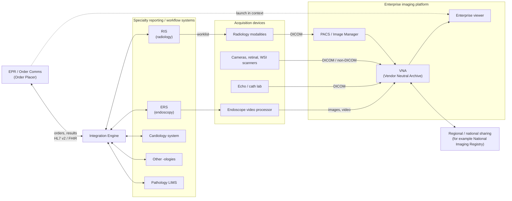

<b>Proof of concept.</b> This implementation guide is a demonstration only. It is
<b>not</b> an authoritative source, is not endorsed by NHS England, IHE or HL7, and
must not be used for implementation or clinical purposes. It is background for the
<a href="https://nw-gmsa.github.io/CancerPathologyReport/">Cancer Pathology Report</a>
proof of concept.

**Enterprise imaging** is the usual umbrella term for all clinical imaging across
a healthcare organisation - radiology and the other imaging specialties, often
called "the -ologies". The HIMSS-SIIM Enterprise Imaging Workgroup defines it as
a set of strategies, initiatives and workflows for capturing and managing all
clinical imaging and multimedia content to enhance the patient record.

### References

- [A Foundation for Enterprise Imaging: HIMSS-SIIM Collaborative White Paper](https://www.ncbi.nlm.nih.gov/pmc/articles/PMC5023525/) (2016) - definition and the elements of an enterprise imaging programme: governance, strategy, platform, clinical images and multimedia content, EHR enterprise viewer, image exchange and image analytics
- [10 Steps to Strategically Build and Implement your Enterprise Imaging System: HIMSS-SIIM Collaborative White Paper](https://www.ncbi.nlm.nih.gov/pmc/articles/PMC6646642/) (2019)

### Terms

| Term | Scope |
|---|---|
| **Enterprise imaging** | All clinical imaging: radiology plus the other imaging specialties. **Used in this guide.** |
| **Medical / clinical imaging** | General plain-English term |
| **Diagnostic imaging** | Often used to mean radiology only - for example the NHS England [Diagnostic Imaging Dataset](https://digital.nhs.uk/data-and-information/data-collections-and-data-sets/data-sets/diagnostic-imaging-data-set) covers radiology |
| **Diagnostics** | Wider: imaging plus pathology, physiological measurement and endoscopy - for example NHS England diagnostic waiting times and community diagnostic centres |
{:.grid}

### Imaging Specialties

| Specialty | Typical images | Typical reporting / workflow system | See |
|---|---|---|---|
| Radiology | X-ray, CT, MRI, ultrasound, mammography, nuclear medicine, PET-CT, interventional radiology | Radiology Information System (RIS) | [Radiology](Radiology.html) |
| Endoscopy | Still images and video from the endoscope | Endoscopy Reporting System (ERS) | [Endoscopy](Endoscopy.html) |
| Cardiology | Echocardiography, cardiac catheterisation, ECG | Cardiology information system / cardiovascular PACS | [Other Imaging Specialties](OtherImaging.html) |
| Ophthalmology | Retinal photography, OCT | Ophthalmology EPR or image management system | [Other Imaging Specialties](OtherImaging.html) |
| Medical photography | Clinical photographs (for example dermatology, wounds) | Medical illustration system, or capture app linked to the EPR | [Other Imaging Specialties](OtherImaging.html) |
| Obstetric and point-of-care ultrasound | Ultrasound outside radiology | Maternity system, or departmental system | [Other Imaging Specialties](OtherImaging.html) |
| Digital pathology | Whole slide images, gross specimen photographs | Pathology LIMS and digital pathology image management system | [Other Imaging Specialties](OtherImaging.html) |
{:.grid}

### System Landscape

Each specialty usually keeps its own **reporting or workflow system**, because it
holds specialty-specific workflow, structured reporting and national data
returns. Images are stored in a shared archive and viewed through one viewer
launched from the EPR.

| Component | Role |
|---|---|
| **EPR / order communications** | Places requests (Order Placer) and receives reports. Usually does **not** capture images or write imaging reports. |
| **Integration engine** | Routes HL7 v2 (and increasingly FHIR) orders, results and patient administration (ADT) messages between the EPR and the specialty systems |
| **Specialty reporting system** (RIS, ERS, ...) | Scheduling, worklists, structured reporting, national data returns (DID, NED). Sends the report back to the EPR. |
| **PACS / Image Manager** | Stores and serves DICOM studies, mainly radiology; provides the diagnostic viewer for reporting |
| **VNA (Vendor Neutral Archive)** | Long-term archive across specialties, DICOM and non-DICOM, independent of any one PACS vendor |
| **Enterprise viewer** | Single viewer for clinicians, launched from the EPR in the patient's context |
| **Regional / national sharing** | Image and report exchange between organisations - see [Image Sharing](ImageSharing.html) |
{:.grid}

Large EPRs sometimes include modules for some specialties (for example
radiology or endoscopy workflow). In most NHS trusts the specialty system stays
separate; this is a local decision - **To confirm** for each trust.

### Relation to Pathology

Pathology is part of **diagnostics** but is not usually counted as imaging, apart
from **digital pathology**. The pathology report is covered by the
[Cancer Pathology Report](https://nw-gmsa.github.io/CancerPathologyReport/) IG.
Imaging and pathology meet in the cancer pathway - see
[Imaging in the Cancer Pathway](CancerPathway.html).
