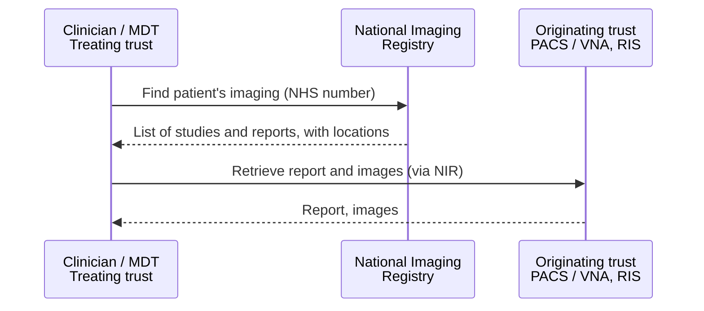

<b>Proof of concept.</b> This implementation guide is a demonstration only. It is
<b>not</b> an authoritative source, is not endorsed by NHS England, IHE or HL7, and
must not be used for implementation or clinical purposes. It is background for the
<a href="https://nw-gmsa.github.io/CancerPathologyReport/">Cancer Pathology Report</a>
proof of concept.

Patients are often imaged at one organisation and treated or discussed at
another - for example imaged at a local hospital and discussed at a specialist
cancer MDT. Images and reports then need to be shared between organisations.

### References

- [National Imaging Registry (NIR)](https://digital.nhs.uk/services/national-imaging-registry) - NHS England; see also the [roadmap](https://digital.nhs.uk/services/national-imaging-registry/national-imaging-registry-roadmap) and [API](https://digital.nhs.uk/developer/api-catalogue/national-imaging-registry-api)
- [IHE Radiology (RAD) profiles](https://profiles.ihe.net/RAD/) - Cross-Enterprise Document Sharing for Imaging (XDS-I.b) and Manifest-based Access to DICOM Objects (MADO)
- [HIMSS-SIIM: A Foundation for Enterprise Imaging](https://www.ncbi.nlm.nih.gov/pmc/articles/PMC5023525/) - image exchange services as part of enterprise imaging

### Approaches

| Approach | How it works | Standards |
|---|---|---|
| **Shared archive or PACS** | Organisations in an imaging network share one PACS / VNA, or federate their archives | DICOM, DICOMweb |
| **Point-to-point transfer** | Images are pushed from one organisation's PACS to another's, for example for a referral | DICOM |
| **Registry and repository (document sharing)** | Each organisation keeps its own images; a registry indexes them and a manifest points to where they are | IHE XDS-I.b, XCA-I, MADO |
| **National registry** | NHS England National Imaging Registry indexes imaging held by organisations in England | FHIR, IHE XCA/XDS, DICOMweb |
{:.grid}

Which approaches a region uses - and the membership of its imaging network - is
**To confirm** for each region.

### National Imaging Registry

The NHS England [National Imaging Registry](https://digital.nhs.uk/services/national-imaging-registry)
lets authorised users find and retrieve a patient's diagnostic imaging and
reports held by other organisations in England, for direct care. The data stays
with the originating organisation. Its API offers FHIR, IHE XCA/XDS and DICOMweb
interfaces. NHS England lists pathology as a possible future diagnostic area.

### Relation to the Cancer Pathway

At the MDT, the radiology-pathology correlation needs the imaging from wherever
the patient was imaged - see [Imaging in the Cancer Pathway](CancerPathway.html).
