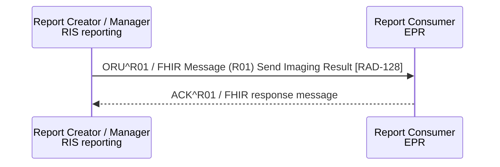

<b>Proof of concept.</b> This implementation guide is a demonstration only. It is
<b>not</b> an authoritative source, is not endorsed by NHS England, IHE or HL7, and
must not be used for implementation or clinical purposes. It is background for the
<a href="https://kevinmayfield.github.io/CancerPathologyReport/">Cancer Pathology Report</a>
proof of concept.

**Send Imaging Result [RAD-128]** (IHE RAD Results Distribution) - the Report
Creator or Report Manager (RIS reporting) sends the imaging result (the
radiology report) to the Report Consumer (EPR and other recipients) as an HL7
v2.5.1 `ORU^R01^ORU_R01`. The result payload is an OBX of value type `TX` (text
report), or `ED` (Base64 PDF - PDF Option; or a CDA document - CDA Option).

RAD-128 is not part of SWF.b. The older equivalent is Structured Report Export
[RAD-28] (IHE RAD Simple Image and Numeric Report, SINR), which sends a DICOM SR
from the Report Manager to the Enterprise Report Repository as an HL7 v2.3.1
`ORU` with plain ASCII text.

<b>In practice</b>, most NHS radiology reports are written as text in the RIS,
not as DICOM SR, so a RIS &#8594; EPR ORU is closer to RAD-128 than to RAD-28.
RAD-28 is still a fair reference for "report exported from the radiology
department to the enterprise as HL7 ORU". This guide uses RAD-128 as the
interaction name and mentions RAD-28 as the older SINR equivalent.

This guide follows the
[NW GMSA ORU_R01](https://nw-gmsa.github.io/en/hl7v2.html#oru_r01-unsolicited-transmission-of-an-observation-message)
conventions (HL7 v2.5.1).

### References

- [IHE RAD Results Distribution (RD) supplement](https://www.ihe.net/uploadedFiles/Documents/Radiology/IHE_RAD_Suppl_RD.pdf) (Rev. 1.2 Trial Implementation, 2019-08-09) - Send Imaging Result [RAD-128]
- [IHE RAD TF-2](https://www.ihe.net/uploadedFiles/Documents/Radiology/IHE_RAD_TF_Vol2.pdf) section 4.28 Structured Report Export [RAD-28] (Rev. 23.0 Final Text, 2025-08-08)
- [NW GMSA HL7 v2 ORU_R01](https://nw-gmsa.github.io/en/hl7v2.html#oru_r01-unsolicited-transmission-of-an-observation-message) and its [OBX type ED](https://nw-gmsa.github.io/en/hl7v2.html#obx-type--ed) convention
- [HL7 v2-to-FHIR ORU_R01 to Bundle](https://build.fhir.org/ig/HL7/v2-to-fhir/ConceptMap-message-oru-r01-to-bundle.html) and [OBX to DocumentReference](https://build.fhir.org/ig/HL7/v2-to-fhir/ConceptMap-segment-obx-to-documentreference.html)

### Message

### FHIR Message

The FHIR equivalent of `ORU^R01` is the [Imaging Result (R01)](MessageDefinition-imaging-result.html)
message: a [Bundle Message](StructureDefinition-BundleMessage.html) whose
[MessageHeader](StructureDefinition-MessageHeader.html) has `eventCoding` v2-0003 `R01`
and whose focus is the [Radiology Diagnostic Report](StructureDefinition-RadiologyDiagnosticReport.html),
following the same pattern as [Imaging Order (O19)](MessageDefinition-imaging-order.html).
The message also carries the report Composition and, for a PDF report, the
DocumentReference and Binary (see below). `ACK^R01` is a FHIR response message
(`MessageHeader.response`).

Example: [Bundle Message - Imaging Result (R01)](Bundle-ImagingResultMessage.html).

| Segment | FHIR |
|---|---|
| PID | [Patient](StructureDefinition-Patient.html) |
| PV1 | `DiagnosticReport.encounter` (PV1-19 visit number) |
| ORC / OBR | [Radiology Diagnostic Report](StructureDefinition-RadiologyDiagnosticReport.html) - see the [Radiology Report](StructureDefinition-RadiologyReport.html) logical model (**Mappings** tab, *Send Imaging Result [RAD-128] - HL7 v2.5.1 to FHIR*) for field-level mappings. OBR-4 (NICIP) maps to `DiagnosticReport.code` |
| OBX (`TX`) | `DiagnosticReport.presentedForm` or `conclusion` - text report |
| OBX (ED / RP) | [DocumentReference](StructureDefinition-DocumentReference.html) + [Binary](StructureDefinition-Binary.html) - see below |
{:.grid}

### Embedded Documents (OBX Type ED, PDF Option)

Following the NW GMSA convention, a report PDF embedded in an OBX of type `ED`
(or referenced by type `RP`) is **not** placed in `Attachment.data`:

- OBX-5 (the document) becomes a [Binary](StructureDefinition-Binary.html)
- the OBX becomes a [DocumentReference](StructureDefinition-DocumentReference.html)
  whose `content.attachment.url` points to the Binary and whose
  `context.related` points to the DiagnosticReport
- the DiagnosticReport points to the Binary through `presentedForm.url`

| OBX field | FHIR |
|---|---|
| OBX-2 `ED` / `RP` | DocumentReference + Binary |
| OBX-3 | `DocumentReference.type` (for example SNOMED CT 4201000179104 Imaging report) |
| OBX-5 ED-3 (data subtype, for example `PDF`) | `Binary.contentType`, `DocumentReference.content.attachment.contentType` |
| OBX-5 ED-5 (data, Base64) | `Binary.data` |
| OBX-5 `RP` | `DocumentReference.content.attachment.url`, `DiagnosticReport.presentedForm.url` |
| OBX-11 | `DocumentReference.docStatus` (`F` final) |
| OBX-14 | `DocumentReference.date`, `content.attachment.creation` |
{:.grid}

Examples: [DocumentReference](DocumentReference-RadiologyReportDocumentReference.html),
[Binary](Binary-RadiologyReportPDF.html) and
[DiagnosticReport](DiagnosticReport-RadiologyDiagnosticReportExample.html).

The NW GMSA IG also links the DiagnosticReport to the DocumentReference with the
R5 `DiagnosticReport.supportingInfo` extension. That extension can only
reference Procedure, Observation, DiagnosticReport or Citation, and the version
NW GMSA pins (1.0.2) is retired, so this guide does not use it (**Open** - for
both IGs).
