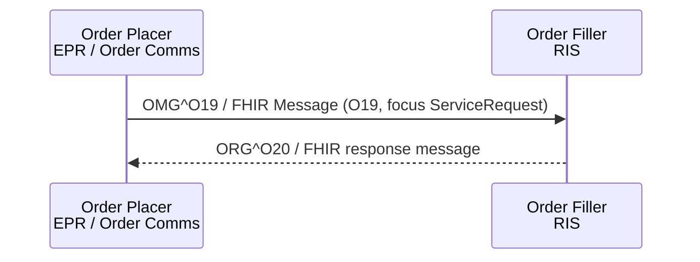

<b>Proof of concept.</b> This implementation guide is a demonstration only. It is
<b>not</b> an authoritative source, is not endorsed by NHS England, IHE or HL7, and
must not be used for implementation or clinical purposes. It is background for the
<a href="https://kevinmayfield.github.io/CancerPathologyReport/">Cancer Pathology Report</a>
proof of concept.

**Placer Order Management [RAD-2]** (IHE RAD Scheduled Workflow.b) - the Order
Placer (EPR or order communications) places, changes or cancels an imaging order
with the Department System Scheduler / Order Filler (RIS).

### References

- [IHE RAD TF-2](https://www.ihe.net/uploadedFiles/Documents/Radiology/IHE_RAD_TF_Vol2.pdf) section 4.2 (Rev. 23.0 Final Text, 2025-08-08)
- [IHE RAD SWF.b supplement](https://ihe.net/uploadedFiles/Documents/Radiology/IHE_RAD_Suppl_SWF.b.pdf) (Rev. 1.7 Trial Implementation, 2019-08-09) - makes HL7 v2.5.1 mandatory
- [NW GMSA HL7 v2](https://nw-gmsa.github.io/en/hl7v2.html) - HL7 v2.5.1 segment conventions (MSH, PID, PV1, ORC, OBR)

### Messages

This guide uses **HL7 v2.5.1**, as SWF.b requires and as the NW GMSA IG uses.

| Message | Trigger | Use |
|---|---|---|
| `OMG^O19^OMG_O19` (ORC-1 `NW`) | New order | Order Placer places a new order |
| `OMG^O19^OMG_O19` (ORC-1 `XO`) | Change order | Order Placer changes an order (v2.5.1 only) |
| `OMG^O19^OMG_O19` (ORC-1 `CA`) | Cancel order | Order Placer cancels an order |
| `ORG^O20^ORG_O20` | Acknowledgement | Order Filler accepts or rejects the order |

Parent / child orders (ORC-1 `PA` / `CH`) are optional in IHE and not covered here.
{:.grid}

### FHIR Message

The FHIR equivalent of `OMG^O19` is the [Imaging Order (O19)](MessageDefinition-imaging-order.html)
message: a [Bundle Message](StructureDefinition-BundleMessage.html) whose
[MessageHeader](StructureDefinition-MessageHeader.html) has `eventCoding` v2-0003 `O19`
and whose focus is the [Radiology Service Request](StructureDefinition-RadiologyServiceRequest.html).
The same message is used for RAD-2 and [RAD-3](RAD-3.html), following the
[Patient Care Coordination](https://github.com/KevinMayfield/PatientCareCoordination)
proof of concept, where a referral (`REF_I12` or `OMG^O19`) becomes one O19 FHIR
Message whatever the HL7 v2 source. `ORG^O20` is a FHIR response message
(`MessageHeader.response`).

Example: [Bundle Message - Imaging Order (O19), new order](Bundle-ImagingOrderMessage.html).

### FHIR Mapping

Indicative mapping to [Radiology Service Request](StructureDefinition-RadiologyServiceRequest.html),
following the HL7 v2-to-FHIR
[ORC](https://build.fhir.org/ig/HL7/v2-to-fhir/ConceptMap-segment-orc-to-servicerequest.html) and
[OBR](https://build.fhir.org/ig/HL7/v2-to-fhir/ConceptMap-segment-obr-to-servicerequest.html) maps.

| HL7 v2.5.1 | FHIR | Note |
|---|---|---|
| MSH-4 / MSH-6 | `MessageHeader.sender` / `destination.receiver` (ODS code) | Sending / receiving facility |
| MSH-9 | `MessageHeader.eventCoding` v2-0003 `O19` | `OMG^O19^OMG_O19` |
| PID-3 | `ServiceRequest.subject` ([Patient](StructureDefinition-Patient.html)) | NHS number and MRN |
| PV1-19 | `ServiceRequest.encounter` | Visit number |
| ORC-1 | `ServiceRequest.status` / `intent` | `NW` new, `XO` change, `CA` cancel |
| ORC-2 | `ServiceRequest.identifier` (type `PLAC`) | Placer order number |
| ORC-12 | `ServiceRequest.requester` | Ordering clinician |
| OBR-4 | `ServiceRequest.code` | **NICIP code (required)**, with SNOMED CT map - see [Terminology](terminology.html) |
| OBR-13 | `ServiceRequest.supportingInfo` | Relevant clinical information |
| OBR-31 | `ServiceRequest.reasonCode` | Reason for study |
| TQ1-9 | `ServiceRequest.priority` | Priority |
{:.grid}

Example: [Radiology Service Request - new order](ServiceRequest-RadiologyServiceRequestNewOrder.html).
The accession number is not known to the Order Placer at this point - it is
assigned by the RIS (see [Filler Order Management [RAD-3]](RAD-3.html) and
[Procedure Scheduled [RAD-4]](RAD-4.html)).
