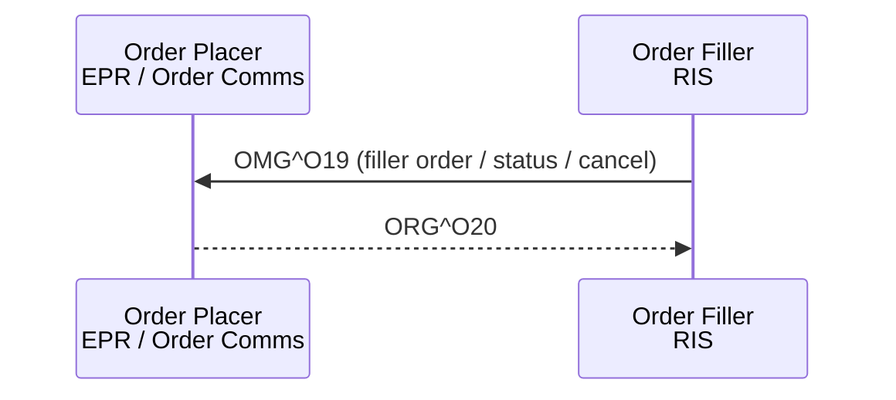

<b>Proof of concept.</b> This implementation guide is a demonstration only. It is
<b>not</b> an authoritative source, is not endorsed by NHS England, IHE or HL7, and
must not be used for implementation or clinical purposes. It is background for the
<a href="https://kevinmayfield.github.io/CancerPathologyReport/">Cancer Pathology Report</a>
proof of concept.

**Filler Order Management [RAD-3]** (IHE RAD Scheduled Workflow.b) - the
Department System Scheduler / Order Filler (RIS) informs the Order Placer of
orders it creates (for example a request received on paper), of status changes,
and of cancellations by the Order Filler.

### References

- [IHE RAD TF-2](https://www.ihe.net/uploadedFiles/Documents/Radiology/IHE_RAD_TF_Vol2.pdf) section 4.3 (Rev. 23.0 Final Text, 2025-08-08)
- [NW GMSA HL7 v2](https://nw-gmsa.github.io/en/hl7v2.html) - HL7 v2.5.1 segment conventions

### Messages

| Message | Trigger | Use |
|---|---|---|
| `OMG^O19^OMG_O19` (ORC-1 `SN`) | New filler order | Order Filler creates an order; ORC-2 placer order number is empty |
| `OMG^O19^OMG_O19` (ORC-1 `XX`) | Change order | Order Filler changes an order it created |
| `OMG^O19^OMG_O19` (ORC-1 `SC`) | Status change | Order Filler reports a change of order status (for example scheduled, in progress, completed) |
| `OMG^O19^OMG_O19` (ORC-1 `OC`) | Cancel | Order Filler cancels the order |
| `ORG^O20^ORG_O20` (ORC-1 `NA`) | Acknowledgement | Order Placer acknowledges, returning its placer order number in ORC-2 |
{:.grid}

### FHIR Mapping

As for [Placer Order Management [RAD-2]](RAD-2.html), plus:

| HL7 v2.5.1 | FHIR | Note |
|---|---|---|
| ORC-3 | `ServiceRequest.identifier` (type `FILL`) | Filler order number. Whether NHS RIS use the accession number as the filler order number is **To confirm** |
| ORC-5 | `ServiceRequest.status` | Order status |
{:.grid}

The ORC-1 / ORC-5 code-by-code mapping to `ServiceRequest.status` is **Open**.
