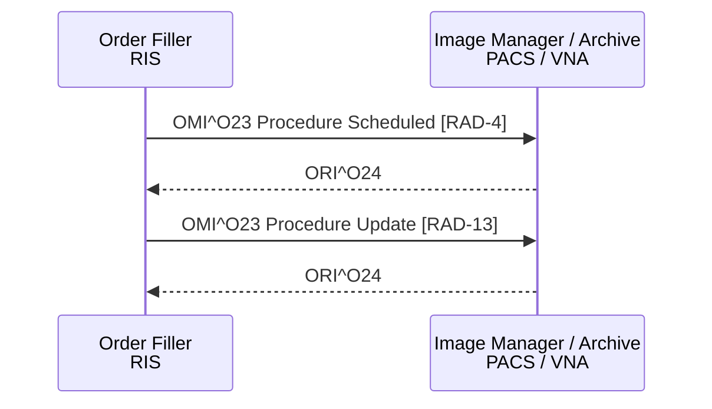

<b>Proof of concept.</b> This implementation guide is a demonstration only. It is
<b>not</b> an authoritative source, is not endorsed by NHS England, IHE or HL7, and
must not be used for implementation or clinical purposes. It is background for the
<a href="https://kevinmayfield.github.io/CancerPathologyReport/">Cancer Pathology Report</a>
proof of concept.

**Procedure Scheduled [RAD-4]** and **Procedure Update [RAD-13]** (IHE RAD
Scheduled Workflow.b) - the Department System Scheduler / Order Filler (RIS)
tells the Image Manager / Image Archive (PACS) which procedures are scheduled,
and later of changes, so that images can be matched to the request.

### References

- [IHE RAD TF-2](https://www.ihe.net/uploadedFiles/Documents/Radiology/IHE_RAD_TF_Vol2.pdf) sections 4.4 and 4.13 (Rev. 23.0 Final Text, 2025-08-08)

### Messages

| Message | Transaction | Use |
|---|---|---|
| `OMI^O23^OMI_O23` | Procedure Scheduled [RAD-4] | First time a Study Instance UID is sent - a procedure has been scheduled |
| `OMI^O23^OMI_O23` | Procedure Update [RAD-13] | Change or cancellation of a procedure already sent |
| `ORI^O24^ORI_O24` | Acknowledgement | |
{:.grid}

### IPC Segment

The OMI message carries one ORC-TQ1-OBR-IPC group per Requested Procedure. The
IPC (Imaging Procedure Control) segment holds the identifiers that tie the order
to the DICOM study (IHE RAD TF-2 Table 4.4-16):

| IPC field | Name | FHIR | DICOM |
|---|---|---|---|
| IPC-1 | Accession Identifier | [Radiological Accession Number](StructureDefinition-RadiologicalAccessionNumber.html) - `ServiceRequest.identifier:accessionNumber`, `ImagingStudy.basedOn.identifier` | (0008,0050), issuer (0008,0051) |
| IPC-2 | Requested Procedure ID | `ServiceRequest.identifier` | (0040,1001) |
| IPC-3 | Study Instance UID | `ImagingStudy.identifier` (Study Instance UID) | (0020,000D) |
| IPC-4 | Scheduled Procedure Step ID | - | (0040,0009) |
| IPC-5 | Modality | `ImagingStudy.series.modality` | (0008,0060) |
{:.grid}

IHE requires the Order Filler to give the assigning authority of the accession
number in IPC-1, and the same value in every IPC segment. Accession numbers are
at most 16 characters (the DICOM Short String limit).

### FHIR

There is no FHIR equivalent of this transaction in this guide. The information
it carries appears in [Radiology Imaging Study](StructureDefinition-RadiologyImagingStudy.html)
once images are acquired - see the [example](ImagingStudy-RadiologyImagingStudyExample.html).
