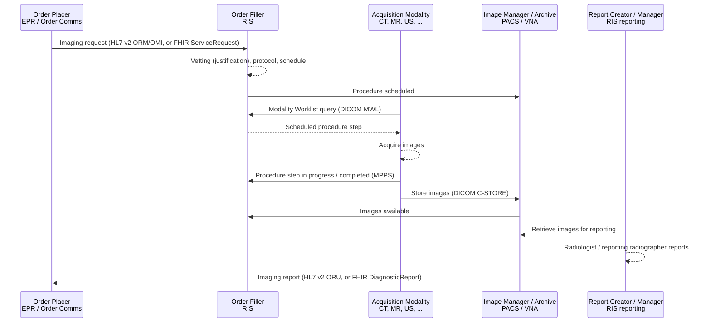

<b>Proof of concept.</b> This implementation guide is a demonstration only. It is
<b>not</b> an authoritative source, is not endorsed by NHS England, IHE or HL7, and
must not be used for implementation or clinical purposes. It is background for the
<a href="https://nw-gmsa.github.io/CancerPathologyReport/">Cancer Pathology Report</a>
proof of concept.

Radiology is the largest imaging service. It uses a **Radiology Information
System (RIS)** for requests, scheduling and reporting, and a **PACS** for images.
Its workflow is described by IHE Radiology **Scheduled Workflow (SWF.b)**.

### References

- [IHE Radiology (RAD) profiles](https://profiles.ihe.net/RAD/)
- [IHE RAD Scheduled Workflow.b (SWF.b) supplement](https://ihe.net/uploadedFiles/Documents/Radiology/IHE_RAD_Suppl_SWF.b.pdf) - Trial Implementation
- [HL7 Europe Imaging Report](https://hl7.eu/fhir/imaging/) - FHIR model of the imaging report
- [NICIP code set](https://digital.nhs.uk/services/terminology-and-classifications/national-interim-clinical-imaging-procedure-nicip-code-set) - NHS England
- [Diagnostic Imaging Dataset (DID)](https://digital.nhs.uk/data-and-information/data-collections-and-data-sets/data-sets/diagnostic-imaging-data-set) - NHS England

### Scheduled Workflow

Indicative mapping of the main SWF.b actors to typical NHS systems:

| IHE actor | Typical NHS system |
|---|---|
| Order Placer | EPR or order communications system (for GP requests, often a separate GP requesting system) |
| Order Filler / Department System Scheduler | RIS |
| Acquisition Modality | CT, MRI, ultrasound, X-ray, mammography, nuclear medicine and PET-CT scanners |
| Image Manager / Image Archive | PACS, with long-term storage in a VNA |
| Report Creator / Report Manager | RIS reporting module, often with voice recognition |
| Image Display | PACS diagnostic workstation; enterprise viewer for clinicians |
{:.grid}

Identifiers that tie the workflow together:

| Identifier | Meaning |
|---|---|
| **Accession number** | Identifies the imaging request / procedure in the RIS; shared by the order, the DICOM study (0008,0050) and the report. NHS Data Dictionary RADIOLOGICAL ACCESSION NUMBER; unique only within the issuing RIS |
| **Study Instance UID** | DICOM identifier of the imaging study |
| **Placer order number** | The EPR's identifier for the request |
{:.grid}

In FHIR these appear as `ServiceRequest.identifier` (placer and accession),
`ImagingStudy.identifier` (Study Instance UID and accession) and
`DiagnosticReport.identifier` - see [FHIR Resources](DataModel.html), which
also lists the report data items described by the Royal College of
Radiologists, mapped to FHIR, HL7 v2 and DICOM.

### Procedure Codes

Radiology procedures in England are coded with **NICIP** (National Interim
Clinical Imaging Procedure) codes, mapped to **SNOMED CT**:

- NICIP is a national set of codes and descriptions for imaging procedures, for
  use in all imaging department systems. A NICIP code identifies both the
  modality and the body site.
- Each NICIP code is mapped to SNOMED CT (the UK Diagnostic Imaging Procedure
  subset). NICIP, with and without SNOMED CT maps, is distributed through
  [TRUD](https://isd.digital.nhs.uk/trud/), with releases on 1 April and 1 October.
- NHS England has consulted on withdrawing NICIP in favour of SNOMED CT only. The
  current status is **To confirm**.

See [Terminology](terminology.html).

### Diagnostic Imaging Dataset

The **Diagnostic Imaging Dataset (DID)** is the national collection of radiology
activity, submitted monthly from RIS. It records the test (NICIP and SNOMED CT
codes), dates (request, test, report) and patient details. It is radiology
activity data, not the report content.

### Out of Scope

- Detailed HL7 v2 message profiles for radiology orders and results
- DICOM conformance of modalities and PACS
- Radiation dose management
