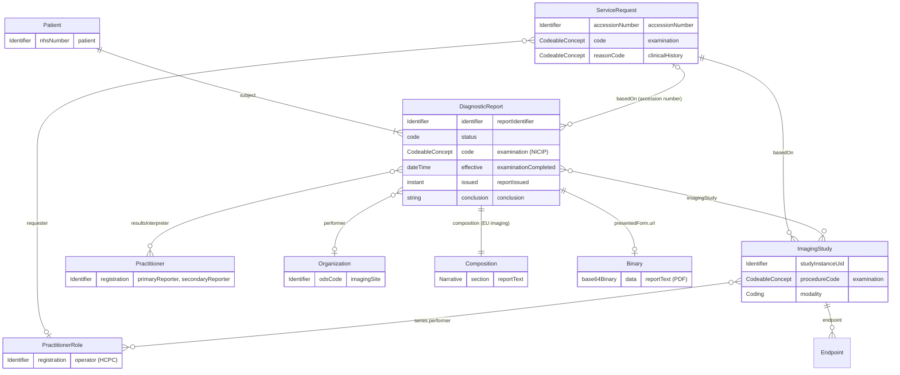
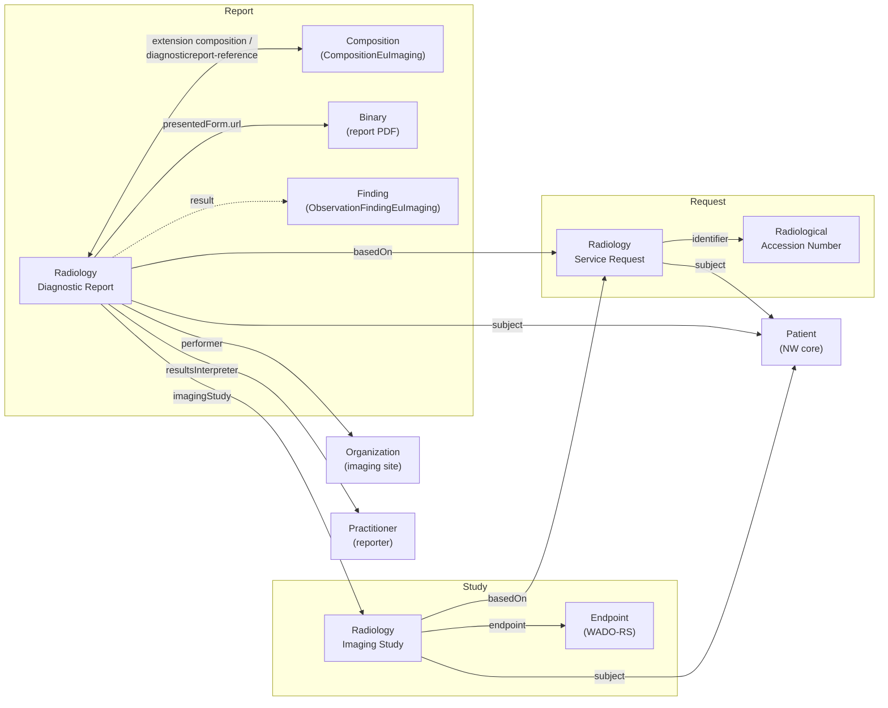
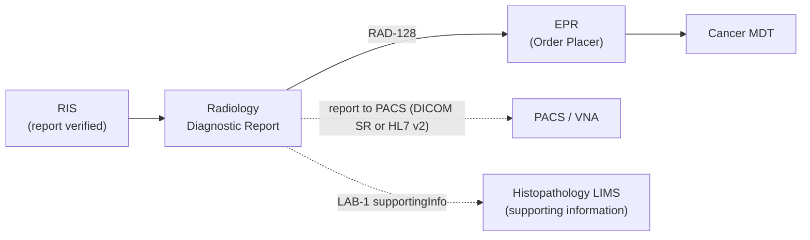
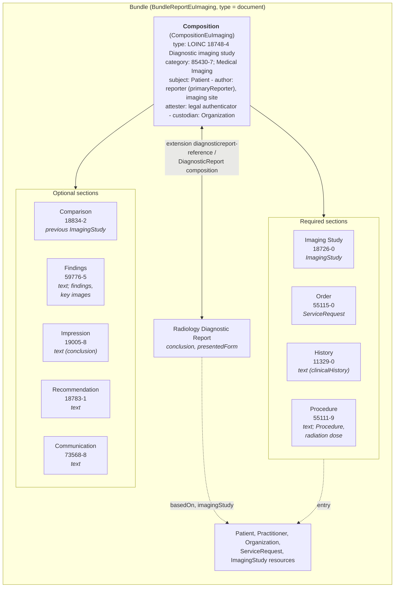

<b>Proof of concept.</b> This implementation guide is a demonstration only. It is
<b>not</b> an authoritative source, is not endorsed by NHS England, IHE or HL7, and
must not be used for implementation or clinical purposes. It is background for the
<a href="https://kevinmayfield.github.io/CancerPathologyReport/">Cancer Pathology Report</a>
proof of concept.

This page describes the common requirement for a **Radiology Report**: the
content a radiology service reports for an imaging examination, based on the
Royal College of Radiologists (RCR) report data for reporting networks. It is the
imaging counterpart of the
[Cancer Pathology Report](https://kevinmayfield.github.io/CancerPathologyReport/PathologyReport.html)
page. The content is defined by the
[Radiology Report logical model](StructureDefinition-RadiologyReport.html), and
exchanged using the [profiles](DataModel.html#profiles) in this guide.

The report has the same basic shape as other diagnostic reports - patient,
order, report and results - but what was examined is an **imaging study**, not a
specimen. Unlike a cancer pathology report, the content of a radiology report is
mostly **narrative**: the RCR data items identify the examination, the people and
the dates, and the findings and conclusion are free text.

### References

- [Radiology reporting networks: understanding the technical options](https://www.rcr.ac.uk/media/wwtp2mif/rcr-publications_radiology-reporting-networks-understanding-the-technical-options_march-2022.pdf) - Royal College of Radiologists, March 2022 (source of the data items; current status **To confirm** - see [FHIR Resources](DataModel.html#imaging-report-data-items))
- [HL7 Europe Imaging Report](https://hl7.eu/fhir/imaging/) (HL7 FHIR) `hl7.fhir.eu.imaging` 1.0.0-ballot - base profiles, including the document sections
- [IHE RAD Interactive Multimedia Report (IMR)](https://profiles.ihe.net/RAD/) (HL7 FHIR) - profile comparison (**Open**)
- [IHE RAD Scheduled Workflow (SWF.b)](SWF.html) and [Send Imaging Result [RAD-128]](RAD-128.html) (HL7 v2.5.1) - `ORU^R01` mappings (indicative)
- [NHS Data Dictionary](https://www.datadictionary.nhs.uk/) - NHS NUMBER, RADIOLOGICAL ACCESSION NUMBER, IMAGING CODE (NICIP), SITE CODE (OF IMAGING)

### Domain Archetype

A **level 2** (field-level) view of the radiology report, showing the FHIR
resources it uses and their key attributes. Each attribute is labelled with its
element in the [logical model](StructureDefinition-RadiologyReport.html).

`ServiceRequest` is referenced by its **accession number**, which links the
request, the DICOM study and the report. The `ServiceRequest` resource itself is
only present when the reporting system shares it.

**Structured and unstructured.** As in the pathology report, the full
human-readable report (`DiagnosticReport.presentedForm`, typically a PDF or
text) sits alongside the structured content. Here the structured content is
small: identifiers, codes, people and dates, and the `conclusion`. HL7 Europe
Imaging also requires the report as a **FHIR document**
(`CompositionEuImaging`, via the `composition` extension), whose sections carry
the narrative - see [FHIR Document](#fhir-document).

### Detailed Model

Cardinalities are from the [logical model](StructureDefinition-RadiologyReport.html),
and are this guide's assumption (**To confirm** against the RCR text). HL7 v2
mappings are **indicative**; the HL7 v2 to FHIR conversion is on
[Send Imaging Result [RAD-128]](RAD-128.html).

#### Patient

<b>HL7 FHIR Profile:</b> <a href="StructureDefinition-Patient.html">Patient</a> (NW core, from <code>patient-eu-core</code>)

| Name | Logical model | Value Set / Data Type | Cardinality | HL7 v2 ORU_R01 | HL7 FHIR |
|---|---|---|---|---|---|
| NHS Number | patient | Identifier | 1..1 | PID-3 | Patient.identifier:nhsNumber |
| Visit number | visitNumber | Identifier | 0..1 | PV1-19 | DiagnosticReport.encounter (Encounter.identifier) |
{:.grid}

#### Request

<b>HL7 FHIR Profile:</b> <a href="StructureDefinition-RadiologyServiceRequest.html">Radiology Service Request</a>

| Name | Logical model | Value Set / Data Type | Cardinality | HL7 v2 ORU_R01 | HL7 FHIR |
|---|---|---|---|---|---|
| Accession number | accessionNumber | [Radiological Accession Number](StructureDefinition-RadiologicalAccessionNumber.html) | 1..1 | ORC-3 / OBR-3 (**To confirm**) | ServiceRequest.identifier:accessionNumber; DiagnosticReport.basedOn.identifier |
| Examination requested | examination | [NICIP (Interweave)](ValueSet-Interweave-NICIP.html), [UK Imaging Procedure](ValueSet-uk-imaging-procedure.html) | 1..* | OBR-4 | ServiceRequest.code |
| Clinical history | clinicalHistory | string | 0..1 | OBX-5 | ServiceRequest.reasonCode / supportingInfo |
{:.grid}

#### Examination

<b>HL7 FHIR Profile:</b> <a href="StructureDefinition-RadiologyImagingStudy.html">Radiology Imaging Study</a>

| Name | Logical model | Value Set / Data Type | Cardinality | HL7 v2 ORU_R01 | HL7 FHIR |
|---|---|---|---|---|---|
| Examination performed | examination | [UK Imaging Procedure](ValueSet-uk-imaging-procedure.html) | 1..* | OBR-4 | ImagingStudy.procedureCode |
| Examination completed | examinationCompleted | dateTime | 0..1 | OBR-7 / OBR-8 | DiagnosticReport.effective[x] |
| Imaging site | imagingSite | Identifier (SITE CODE (OF IMAGING) or ODS code - **Open**) | 0..1 | PV1-3 (facility) | DiagnosticReport.performer:organization |
| Operator (radiographer) | operator | Identifier (HCPC) | 0..* | OBR-34 | ImagingStudy.series.performer |
| Radiographer comments | radiographerComments | string | 0..1 | NTE-3 | DiagnosticReport.extension:note |
{:.grid}

The modality, series and Study Instance UID come from DICOM, not from the RCR
data items - see [Imaging Study Data Items](DataModel.html#imaging-study-data-items).

#### Report

<b>HL7 FHIR Profile:</b> <a href="StructureDefinition-RadiologyDiagnosticReport.html">Radiology Diagnostic Report</a>

| Name | Logical model | Value Set / Data Type | Cardinality | HL7 v2 ORU_R01 | HL7 FHIR |
|---|---|---|---|---|---|
| Report identifier | reportIdentifier | Identifier | 0..1 | OBR-3 | DiagnosticReport.identifier |
| Report status | - | FHIR diagnostic-report-status | 1..1 | OBR-25 | DiagnosticReport.status |
| Diagnostic service section | diagnosticServiceSection | HL7 v2 table 0074 (for example `RAD`) | 0..1 | OBR-24 | DiagnosticReport.category:diagnostic-service |
| Examination reported | examination | [NICIP (Interweave)](ValueSet-Interweave-NICIP.html) and/or LOINC report type | 1..* | OBR-4 | DiagnosticReport.code |
| Final report issued | reportIssued | dateTime | 0..1 | OBR-22 | DiagnosticReport.issued |
| Primary reporter | primaryReporter | Identifier (GMC, HCPC) | 0..1 | OBR-32 | DiagnosticReport.resultsInterpreter |
| Secondary reporter | secondaryReporter | Identifier (GMC, HCPC) | 0..* | OBR-33 | DiagnosticReport.resultsInterpreter |
| Report text | reportText | string / Attachment | 1..1 | OBX-5 (type TX, or ED - PDF Option) | DiagnosticReport.presentedForm; Composition sections |
| Conclusion | conclusion | string | 0..1 | OBX-5 (impression OBX - **Open**) | DiagnosticReport.conclusion |
{:.grid}

How to tell the primary reporter from secondary reporters in
`resultsInterpreter` is **Open**.

### Results

The RCR data items have **no coded findings**: findings and conclusion are
narrative. HL7 Europe Imaging allows coded content when a reporting system
produces it:

| Content | Profile | Where | Notes |
|---|---|---|---|
| Finding | `ObservationFindingEuImaging` | `DiagnosticReport.result`; Findings section entry | For example a measured lesion. Not produced by typical NHS RIS today (**To confirm**) |
| Impression | `HL7IDRImpression` extension | `DiagnosticReport.extension:impression`; Impression section entry | Coded conclusion, for example a `Condition` |
| Key image | `ImagingSelectionKeyImageEuImaging`, `DocumentReferenceKeyImageEuImaging` | Findings or Impression section entry | Key images flagged by the radiologist |
| Radiation dose | `ObservationRadiationDoseEuImaging` | Procedure section entry | Dose for the examination |
| Comparison study | `HL7IDRComparisonStudy` extension | Comparison section entry | Previous `ImagingStudy` |
| Clinical stage (cTNM) | **Open** | - | For cancer staging scans, a radiological TNM could be coded. COSD v10 Imaging has no TNM items - see [Imaging in the Cancer Pathway](CancerPathway.html) |
{:.grid}

#### Profile relationships

How the profiles relate to each other, in the same style as the Cancer
Pathology Report profile diagram. Arrow labels are the FHIR elements that hold
the reference. Dashed arrows are optional links that the profiles here do not
constrain. Click a box to open its profile.

#### Report flow

### FHIR Document

The report above is a `DiagnosticReport` - suited to workflow exchange. For
**document sharing** (for example IHE XDS/MHD, or the NHS England National
Record Locator) the same report is sent as a FHIR Document: a `Bundle` of type
`document` (`BundleReportEuImaging`) with a `Composition` as its first entry.

Unlike the pathology report - where no source defines a document layout and one
had to be inferred - **HL7 Europe Imaging defines the layout**.
`CompositionEuImaging` has fixed, LOINC-coded sections, and
`DiagnosticReportEuImaging` requires the Composition (extension `composition`,
1..1). Every radiology report conforming to this guide is therefore also a FHIR
document.

#### Layout

| Section | Code | Cardinality | Content | Logical model |
|---|---|---|---|---|
| Imaging Study | LOINC `18726-0` Radiology studies (set) | 1..1 | Entry: Radiology Imaging Study | examination, examinationCompleted |
| Order | LOINC `55115-0` Requested imaging studies information | 1..1 | Entry: Radiology Service Request | accessionNumber, examination |
| History | LOINC `11329-0` History general | 1..1 | Text; entries for problems, medication, implants | clinicalHistory |
| Procedure | LOINC `55111-9` Current imaging procedure descriptions | 1..1 | Text (technique, contrast); entries Procedure, adverse event, radiation dose | examination, radiographerComments (**Open**) |
| Comparison | LOINC `18834-2` Radiology Comparison study | 0..1 | Text; entry previous ImagingStudy | Part of reportText |
| Findings | LOINC `59776-5` Procedure findings | 0..1 | Text; entries findings, key images | Part of reportText |
| Impression | LOINC `19005-8` Radiology Imaging study [Impression] | 0..1 | Text; entries impressions | conclusion |
| Recommendation | LOINC `18783-1` Radiology Study recommendation | 0..1 | Text | Part of reportText |
| Communication | LOINC `73568-8` Communication of critical results | 0..1 | Text | Part of reportText |
| Report | LOINC `LP173421-1` Report | 0..1 | All content in one section | reportText, when it cannot be split |
{:.grid}

Section codes and cardinalities are from `CompositionEuImaging`
(`hl7.fhir.eu.imaging` 1.0.0-ballot); displays checked on tx.fhir.org.

#### What the reader sees

As for the pathology report, every section carries its own human-readable
narrative (`Composition.section.text`), and a viewer shows those narratives in
order, top to bottom, like the pages of a printed report. The coded entries sit
behind the narrative for computers to use, but **the reader never needs to see
them**.

The mock below is a fictitious staging CT for the same colorectal cancer pathway
as the Cancer Pathology Report mock, for the NW GMSA test patient used in this
guide's [examples](#examples). The small grey labels show which part of the FHIR
Document each block comes from - a real viewer would not show them.

Composition.title &middot; type LOINC 18748-4 &middot; category 85430-7

  

    
Radiology Report

    
CT Thorax abdomen pelvis with contrast

    
Manchester University NHS Foundation Trust (ODS R0A)

  

  
FICTITIOUS EXAMPLE

Composition.subject (Patient) &middot; Composition.identifier &middot; Composition.date &middot; Composition.status &middot; section Order (55115-0)

<table style="width:100%; font-size:14px; margin-bottom:14px; border:none;">
<tr><td style="border:none; padding:2px 8px 2px 0;"><b>Patient</b></td><td style="border:none;">MANCHESTER, Sansa</td><td style="border:none;"><b>NHS Number</b></td><td style="border:none;">973 738 3192</td></tr>
<tr><td style="border:none; padding:2px 8px 2px 0;"><b>Date of birth</b></td><td style="border:none;">21-Sep-1972</td><td style="border:none;"><b>Accession number</b></td><td style="border:none;">RAD26110001</td></tr>
<tr><td style="border:none; padding:2px 8px 2px 0;"><b>MRN</b></td><td style="border:none;">R0A4990415</td><td style="border:none;"><b>Report number</b></td><td style="border:none;">RPT-26-0005678</td></tr>
<tr><td style="border:none; padding:2px 8px 2px 0;"><b>Requested by</b></td><td style="border:none;">Colorectal Surgery</td><td style="border:none;"><b>Report status</b></td><td style="border:none;">Final</td></tr>
<tr><td style="border:none; padding:2px 8px 2px 0;"><b>Examination</b></td><td style="border:none;">28-Oct-2026 14:02</td><td style="border:none;"><b>Reported</b></td><td style="border:none;">29-Oct-2026 09:45</td></tr>
</table>

section &middot; Imaging Study (18726-0) &middot; section.text, entry ImagingStudy

<b>Examination.</b> CT thorax, abdomen and pelvis with contrast (NICIP CCHAPC). 1 series, 412 images. View images

section &middot; History (11329-0) &middot; section.text

<b>Clinical history.</b> Caecal mass found at colonoscopy; biopsy awaited. Staging of suspected colorectal cancer.

section &middot; Procedure (55111-9) &middot; section.text, entry Procedure, radiation dose

<b>Technique.</b> Portal venous phase CT of the thorax, abdomen and pelvis following 100 ml intravenous contrast. No immediate adverse reaction. DLP 820 mGy&middot;cm.

section &middot; Comparison (18834-2) &middot; section.text

<b>Comparison.</b> No previous cross-sectional imaging available.

section &middot; Findings (59776-5) &middot; section.text, entries findings, key images

<b>Findings.</b>

<i>Thorax:</i> No pulmonary nodules or masses. No mediastinal or hilar lymphadenopathy. No pleural effusion. 
<i>Abdomen and pelvis:</i> Irregular circumferential wall thickening of the caecum over 45 mm, with stranding of the adjacent pericolic fat, in keeping with the known tumour. Two pericolic lymph nodes, the largest 8 mm short axis. The liver is normal, with no focal lesion. No ascites or peritoneal deposits. The remaining bowel, kidneys, adrenals, pancreas and spleen are unremarkable. No suspicious bone lesion.

section &middot; Impression (19005-8) &middot; section.text &middot; DiagnosticReport.conclusion

<b>Conclusion.</b> Caecal tumour extending beyond the bowel wall, with two suspicious pericolic lymph nodes. No evidence of distant metastases. Radiological stage T3 N1 M0.

section &middot; Recommendation (18783-1) &middot; section.text

<b>Recommendation.</b> Discuss at the colorectal cancer MDT.

section &middot; Communication (73568-8) &middot; section.text

<b>Communication.</b> Not an urgent unexpected finding. Report added to the colorectal MDT list on 29-Oct-2026.

Composition.author (Practitioner) &middot; Composition.attester &middot; Composition.custodian (Organization) &middot; ImagingStudy.series.performer

Reported by: <b>Dr Robin EXAMPLE</b>, Consultant Radiologist (GMC C1234567) 
Examination performed by: Jordan SAMPLE, Diagnostic Radiographer (HCPC RA123456) 
Verified: 29-Oct-2026 09:45 &nbsp;&middot;&nbsp; Manchester University NHS Foundation Trust

**Reading the mock**

- The **header** (patient, accession and report numbers, dates, requester)
  comes from the `Composition` itself, its `subject`, and the Order section's
  `ServiceRequest`.
- Each heading and paragraph is one `Composition.section`, shown from its
  `section.text`, in the order the sections appear. The four required sections
  (Imaging Study, Order, History, Procedure) are always present, even if short.
- The **Conclusion** is the Impression section; the same text is
  `DiagnosticReport.conclusion` and RCR `conclusion`.
- **View images** stands for the `ImagingStudy.endpoint` (WADO-RS): the
  document points to the images rather than containing them.
- The **sign-off** comes from `Composition.author`, `attester` and `custodian`;
  the radiographer comes from the `ImagingStudy`.

**Points to note**

- Most NHS radiology reports today are one block of text (HL7 v2 OBX type TX)
  with conventional headings. Splitting that text into the EU sections needs the
  reporting system to keep the headings apart, or the text goes in the single
  **Report** section (`LP173421-1`) - which is realistic for NHS systems is
  **Open**.
- `CompositionEuImaging` requires History and Procedure even when the report
  has no separate text for them. How to fill them from a one-block report is
  **Open** (`emptyReason` may apply).
- The radiological stage in the mock is narrative only; coding cTNM is **Open**
  (see [Results](#results)).
- The structured entries are the **same resources** the `DiagnosticReport`
  references, so a receiver can use either view.
- The [Composition example](Composition-RadiologyCompositionExample.html) carries
  the text of the mock, and `DiagnosticReport.conclusion` in the
  [report example](DiagnosticReport-RadiologyDiagnosticReportExample.html) is the
  Impression text.

### Examples

A staging CT of the thorax, abdomen and pelvis at Manchester University NHS
Foundation Trust (R0A), for the NW GMSA test patient MANCHESTER Sansa.
Practitioners, identifiers and report text are fictional.

| Example | Profile |
|---|---|
| [Radiology Service Request](ServiceRequest-RadiologyServiceRequestExample.html) | Radiology Service Request |
| [Radiology Imaging Study](ImagingStudy-RadiologyImagingStudyExample.html), with a [WADO-RS Endpoint](Endpoint-EndpointWADORS.html) | Radiology Imaging Study |
| [Radiology Diagnostic Report](DiagnosticReport-RadiologyDiagnosticReportExample.html), with the [report PDF](Binary-RadiologyReportPDF.html) | Radiology Diagnostic Report |
| [Composition](Composition-RadiologyCompositionExample.html) | `CompositionEuImaging` |
| [Imaging Result (R01)](Bundle-ImagingResultMessage.html) | Bundle Message ([RAD-128](RAD-128.html)) |
{:.grid}
