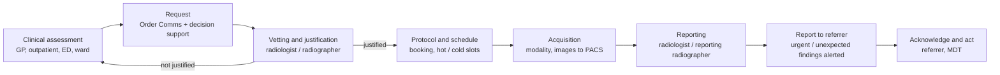
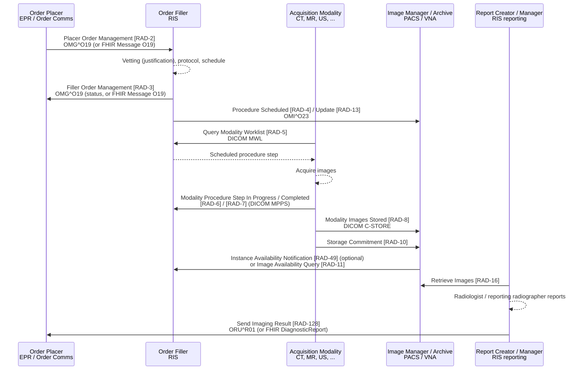

<b>Proof of concept.</b> This implementation guide is a demonstration only. It is
<b>not</b> an authoritative source, is not endorsed by NHS England, IHE or HL7, and
must not be used for implementation or clinical purposes. It is background for the
<a href="https://kevinmayfield.github.io/CancerPathologyReport/">Cancer Pathology Report</a>
proof of concept.

Radiology is the largest imaging service. It uses a **Radiology Information
System (RIS)** for requests, scheduling and reporting, and a **PACS** for images.
Its workflow is described by IHE Radiology **Scheduled Workflow (SWF.b)**.

### References

- [IHE Radiology (RAD) profiles](https://profiles.ihe.net/RAD/)
- [IHE RAD Scheduled Workflow.b (SWF.b) supplement](https://ihe.net/uploadedFiles/Documents/Radiology/IHE_RAD_Suppl_SWF.b.pdf) - Trial Implementation
- [HL7 Europe Imaging Report](https://hl7.eu/fhir/imaging/) - FHIR model of the imaging report
- [NICIP code set](https://digital.nhs.uk/services/terminology-and-classifications/national-interim-clinical-imaging-procedure-nicip-code-set) - NHS England
- [Diagnostic Imaging Dataset (DID)](https://digital.nhs.uk/data-and-information/data-collections-and-data-sets/data-sets/diagnostic-imaging-data-set) - NHS England

### The Imaging Pathway

Seen from the patient and the referrer, a radiology examination is a short
pathway embedded in the wider clinical (or cancer) pathway: the clinician asks a
question, imaging answers it, and the clinician acts on the answer.

| Step | What happens | National guidance | SWF transaction |
|---|---|---|---|
| Request | The referrer requests an examination, ideally electronically with clinical decision support. GPs have direct access to imaging for suspected cancer | GIRFT recommends Order Comms as the standard method for all imaging requests and wider use of RCR [iRefer](https://www.irefer.org.uk/) (CDS-enabled). NICE [QS124](https://www.nice.org.uk/guidance/qs124/chapter/Quality-statement-1-Direct-access-to-diagnostic-tests) statement 1 and [NG12](https://www.nice.org.uk/guidance/ng12) - direct access to CT, MRI, ultrasound and X-ray for suspected cancer | [RAD-2](RAD-2.html) |
| Vetting and justification | A practitioner checks the request is appropriate and justified before any exposure, may change the examination or decline it | Justification is a legal duty under [IR(ME)R 2017](https://www.legislation.gov.uk/uksi/2017/1322/contents/made) for ionising radiation (not MRI or ultrasound); referral guidelines (iRefer) support it | [RAD-3](RAD-3.html) (status / changes) |
| Protocol and schedule | The examination is protocolled and booked; the RIS assigns the accession number | GIRFT: separate urgent ("hot") from pre-booked ("cold") work, online booking and extended hours. NHS England [diagnostic waiting times (DM01)](https://www.england.nhs.uk/statistics/statistical-work-areas/diagnostics-waiting-times-and-activity/) - request to test | [RAD-4](RAD-4.html) / [RAD-13](RAD-4.html), RAD-5 |
| Acquisition | The modality acquires the images and sends them to PACS | - | RAD-6, RAD-7, RAD-8, RAD-10 |
| Reporting | The images are reported; reporting may be done remotely, across an imaging network or outsourced | NHS England [diagnostic imaging reporting turnaround times](https://www.england.nhs.uk/long-read/diagnostic-imaging-reporting-turnaround-times/) (August 2023) - see below. GIRFT: remote reporting by radiologists and reporting radiographers, imaging networks | RAD-16 |
| Report to referrer | The verified report is sent to the referrer; urgent or unexpected findings are alerted | NHS England TAT guidance requires local SOPs for urgent and unexpected findings, referring to RCR alerts guidance | [RAD-128](RAD-128.html) |
| Acknowledge and act | The referrer acknowledges the result and acts on it - for suspected cancer, within the Faster Diagnosis Standard (diagnosis or ruling out within 28 days of referral) | NHS England [cancer waiting times](https://www.england.nhs.uk/statistics/statistical-work-areas/cancer-waiting-times/) - Faster Diagnosis Standard | - (see [Imaging in the Cancer Pathway](CancerPathway.html)) |
{:.grid}

**Reporting turnaround times** (NHS England, effective 9 August 2023), measured
from the examination to a verified report being available to the referrer; no
report should take longer than 4 weeks from image acquisition:

| Referral category | CT, MRI | Plain film |
|---|---|---|
| ED / acutely unwell | 12 hours, under 4 hours after acquisition for ED or acutely unwell inpatients | 12 hours, ideally under 4 hours in working hours |
| Non-urgent inpatients | 24 hours | 7 days (other inpatients) |
| Outpatient Faster Diagnosis Standard cancer pathway | 3 days | 3 days |
| Urgent GP and outpatients | 7 days | 7 days |
| Routine GP and outpatients | 28 days | 28 days |
{:.grid}

Ultrasound and interventional radiology are reported at the time of the
examination. Fluoroscopy and nuclear medicine (including PET-CT) follow the
CT/MRI categories. See the guidance for the full table.

Further references for the pathway:

- [GIRFT Radiology national specialty report](https://gettingitrightfirsttime.co.uk/wp-content/uploads/2020/11/GIRFT-radiology-report.pdf) (November 2020) - including recommendation 9: all trusts to meet RCR IT standards, Order Comms as the standard request method, new PACS/RIS to meet RCR standards for image and report sharing
- NHS England [Diagnostic imaging network implementation guide](https://www.england.nhs.uk/publication/diagnostic-imaging-network-implementation-guide/)
- NICE has no radiology-wide pathway guidance; imaging appears within condition-specific guidance such as NG12 (suspected cancer)

### Scheduled Workflow

SWF.b requires HL7 v2.5.1 for its HL7 transactions (the version the NW GMSA IG
also uses). Transactions covered by this guide:

| Transaction | From - To | Standard | Page |
|---|---|---|---|
| Patient Registration [RAD-1], Patient Update [RAD-12] | ADT - Order Placer, Order Filler, Image Manager | HL7 v2.5.1 ADT | Not covered - see [NW GMSA](https://nw-gmsa.github.io/en/hl7v2.html) |
| Placer Order Management [RAD-2] | Order Placer - Order Filler | HL7 v2.5.1 `OMG^O19`; FHIR Message [Imaging Order (O19)](MessageDefinition-imaging-order.html) | [RAD-2](RAD-2.html) |
| Filler Order Management [RAD-3] | Order Filler - Order Placer | HL7 v2.5.1 `OMG^O19`; FHIR Message [Imaging Order (O19)](MessageDefinition-imaging-order.html) | [RAD-3](RAD-3.html) |
| Procedure Scheduled [RAD-4], Procedure Update [RAD-13] | Order Filler - Image Manager | HL7 v2.5.1 `OMI^O23` | [RAD-4](RAD-4.html) |
| Query Modality Worklist [RAD-5], Modality Procedure Step [RAD-6/7], Modality Images Stored [RAD-8], Storage Commitment [RAD-10], Image Availability Query [RAD-11], Retrieve Images [RAD-16], Instance Availability Notification [RAD-49] (optional) | Modality, Image Manager, Order Filler, Image Display | DICOM | Out of scope |
| Send Imaging Result [RAD-128] (Results Distribution, not SWF.b; older equivalent RAD-28) | Report Creator / Manager - Report Consumer | HL7 v2.5.1 `ORU^R01` | [RAD-128](RAD-128.html) |
{:.grid}

Indicative mapping of the main SWF.b actors to typical NHS systems:

| IHE actor | Typical NHS system |
|---|---|
| Order Placer | EPR or order communications system (for GP requests, often a separate GP requesting system) |
| Order Filler / Department System Scheduler | RIS |
| Acquisition Modality | CT, MRI, ultrasound, X-ray, mammography, nuclear medicine and PET-CT scanners |
| Image Manager / Image Archive | PACS, with long-term storage in a VNA |
| Report Creator / Report Manager | RIS reporting module, often with voice recognition |
| Image Display | PACS diagnostic workstation; enterprise viewer for clinicians |
{:.grid}

Identifiers that tie the workflow together:

| Identifier | Meaning |
|---|---|
| **Accession number** | Identifies the imaging request / procedure in the RIS; shared by the order, the DICOM study (0008,0050) and the report. NHS Data Dictionary RADIOLOGICAL ACCESSION NUMBER; unique only within the issuing RIS |
| **Study Instance UID** | DICOM identifier of the imaging study |
| **Placer order number** | The EPR's identifier for the request |
{:.grid}

In FHIR these appear as `ServiceRequest.identifier` (placer and accession),
`ImagingStudy.identifier` (Study Instance UID and accession) and
`DiagnosticReport.identifier` - see [FHIR Resources](DataModel.html), which
also lists the report data items described by the Royal College of
Radiologists, mapped to FHIR, HL7 v2 and DICOM.

### Procedure Codes

Radiology procedures in England are coded with **NICIP** (National Interim
Clinical Imaging Procedure) codes, mapped to **SNOMED CT**:

- NICIP is a national set of codes and descriptions for imaging procedures, for
  use in all imaging department systems. A NICIP code identifies both the
  modality and the body site.
- Each NICIP code is mapped to SNOMED CT (the UK Diagnostic Imaging Procedure
  subset). NICIP, with and without SNOMED CT maps, is distributed through
  [TRUD](https://isd.digital.nhs.uk/trud/), with releases on 1 April and 1 October.
- NHS England has consulted on withdrawing NICIP in favour of SNOMED CT only. The
  current status is **To confirm**.

This guide codes NICIP with the Interweave NICIP CodeSystem - the NICIP code is
required on the request and used on the report, as in the
[Interweave FHIR IG](https://fhir.interweavedigital.com/R4/StructureDefinition-Interweave-DiagnosticReport.html).
See [Terminology](terminology.html).

### Diagnostic Imaging Dataset

The **Diagnostic Imaging Dataset (DID)** is the national collection of radiology
activity, submitted monthly from RIS. It records the test (NICIP and SNOMED CT
codes), dates (request, test, report) and patient details. It is radiology
activity data, not the report content.

### Out of Scope

- Detailed HL7 v2 message profiles for radiology orders and results
- DICOM conformance of modalities and PACS
- Radiation dose management
